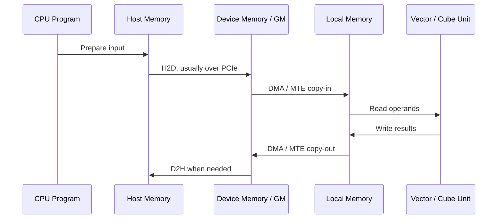

# Data movement and H2D

## A tensor's typical journey

Two types of transfer are often confused:

- **Host ↔ Device** crosses CPU and NPU address spaces and is commonly called H2D or D2H.
- **Device Global ↔ On-chip Local** crosses NPU memory hierarchy levels and commonly uses DMA/MTE engines.

An H2D operation completing means that data reached Device Memory. It does not mean the data is already in the on-chip
buffer where an AI Core can consume it efficiently.

## Synchronous and asynchronous copies

- A **synchronous copy** usually finishes before the API returns. It is simple but may block the calling thread.
- An **asynchronous copy** is submitted to a stream or queue and may overlap compute. Dependencies, events, and buffer
  lifetimes must be correct.
- **Pinned Host Memory** can reduce the work required to prepare a DMA transfer and often improves sustained H2D/D2H.
- **Batching** matters because submission overhead and latency can dominate many small transfers.

## Why measured bandwidth is below the link rate

Effective throughput cannot exceed the narrowest component:

`B_effective ≤ min(B_host_memory, B_PCIe, B_device_memory, B_copy_engine)`

Protocol overhead, transfer size, remote NUMA memory, shared PCIe switches, memory registration, synchronization, and
contention reduce it further.

## Minimal H2D/D2H checklist

1. Record direction, size, count, and whether the operation is synchronous or asynchronous.
2. Check whether Host buffers are pinned and whether they are allocated on the nearest NUMA node.
3. Inspect the NPU-to-CPU/PCIe Root Complex topology for cross-socket paths or shared uplinks.
4. Measure cold start, steady-state large transfers, and many small transfers separately.
5. Distinguish API submission time, stream completion time, and end-to-end application time.
6. Check whether copies overlap compute and whether the application makes avoidable H2D → D2H round trips.

## Direction quick reference

| Source | Destination | Common name | Typical path |
| --- | --- | --- | --- |
| Host DRAM | Device Memory | H2D | CPU memory → PCIe → NPU memory |
| Device Memory | Host DRAM | D2H | NPU memory → PCIe → CPU memory |
| Device A | Device B | D2D / P2P | PCIe, a dedicated interconnect, or a network |
| Device GM | AI Core Local Memory | Copy-in | On-device DMA/MTE transfer |
| AI Core Local Memory | Device GM | Copy-out | On-device DMA/MTE transfer |

## References

- [Ascend C documentation](https://asc.gitcode.com/): *Heterogeneous System*.
- [Ascend documentation](https://www.hiascend.com/document): *Bandwidth Test*.
