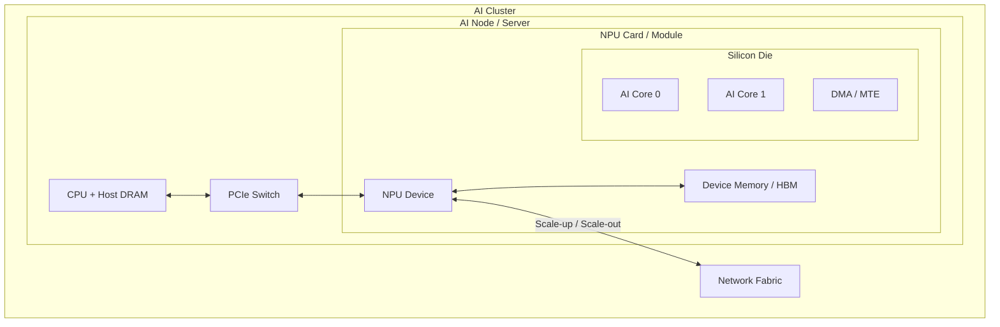

# NPU mental model

## From silicon to a cluster

This is a generic model for locating terms, not an exact block diagram of a particular product.

## Five layers that are easy to confuse

| Layer | Meaning | Do not assume it is |
| --- | --- | --- |
| Die | A piece of silicon cut from a wafer; a package may contain one or more dies | A card or server |
| Chip / Package | One or more dies and their package substrate in an installable component | Always a single die |
| Card / Module | Board with packages, power, connectors, and possibly memory | One AI Core |
| Device | An accelerator object exposed and managed by the software runtime | Always one physical chip |
| AI Core | A compute resource inside the NPU for matrix, vector, or scalar work | The entire NPU card |

Virtualization and multi-die or multi-chip designs break the intuition that one number means one physical chip. During
diagnosis, identify whether a number is a PCIe BDF, runtime Device ID, physical Chip ID, Die ID, or Rank ID.

## Host and Device

- **Host** usually means the CPU side, including CPU cores and Host DRAM.
- **Device** usually means the NPU side, including Device Memory, compute cores, and device execution resources.
- The Host manages resources, prepares memory, and submits work; the Device performs compute-intensive tasks.
- Host and Device commonly have separate address spaces. Data must be copied explicitly or managed by a unified-memory
  mechanism.

## A generic AI Core

- A **Scalar unit** handles addressing, loops, branches, and instruction dispatch.
- A **Vector unit** performs element-wise, vector, and some reduction operations.
- A **Cube / Matrix unit** performs dense tensor operations such as matrix multiply-accumulate.
- **Local Memory** is small, low-latency, high-bandwidth on-chip storage near the compute units.
- **DMA / MTE** moves data between Device Global Memory and levels of Local Memory.

Optimization is not only about faster arithmetic. A high-performance kernel pipelines copy-in, compute, and copy-out to
hide data-movement latency.

## References

- [Ascend C documentation](https://asc.gitcode.com/): *Heterogeneous System and Programming Model*.
- [Ascend documentation](https://www.hiascend.com/document): *Abstract Hardware Architecture*.
