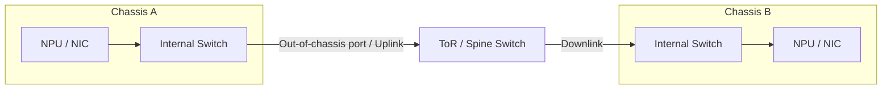

# Network planes and uplinks

## Why split a network into planes

AI cluster traffic has different goals. Some traffic requires very low latency and stable bandwidth, some requires bulk
throughput, and some prioritizes reliable management. A network plane groups or isolates traffic by purpose, addressing,
VLAN, QoS, switching fabric, or physical ports.

| Plane | Typical traffic | Primary concerns |
| --- | --- | --- |
| Parameter | Gradients, weights, activations, and other tensors | Latency, bandwidth, jitter, collectives |
| Storage / sample | Datasets, models, checkpoints, and logs | Throughput, bursts, storage concurrency |
| Service | Inference requests, training I/O, and service calls | Availability, isolation, traffic direction |
| Management | SSH, monitoring, deployment, and out-of-band access | Reliability, security, maintainability |

Planes may use separate physical fabrics, or share NICs and switches with logical isolation through VLANs, subnets, and
QoS. Their names and exact boundaries are not universal standards.

## Control plane and data plane

Control plane and data plane describe **functional roles**:

- The control plane performs discovery, configuration, connection setup, route selection, memory registration, resource
  creation, and state maintenance.
- The data plane performs frequent sends, receives, reads, writes, or copies of actual payloads.
- A common lifecycle is “set up once on the control plane, execute many times on the data plane, then tear down.”

Do not equate “data plane” with “storage plane.” AllReduce gradient traffic belongs to a parameter network and is also a
data-plane payload in the communication system.

## What is an out-of-chassis port?

“Out-of-chassis port” is operational shorthand rather than a standardized protocol term. It usually means the port used
when traffic leaves the current physical boundary:

- From a server's perspective, it may be a NIC uplink to a top-of-rack switch.
- From a chassis perspective, it may be a port from an internal switch module to an external switch.
- From a rack or pod perspective, it may be an uplink to a higher-level spine or core switch.



When traffic “uses the out-of-chassis port,” ask which physical boundary “chassis” means. Then identify the port owner,
speed, aggregation mode, and number of switching stages.

## Example parameter synchronization path

```text
AI Core
  → Device Memory
  → NPU communication engine or NIC
  → In-chassis link
  → Out-of-chassis port
  → ToR / Spine
  → Peer uplink
  → Peer NPU
```

Whether the path traverses the Host, PCIe, a dedicated interconnect, or a RoCE network depends on the platform and the
communication algorithm. For performance diagnosis, draw the real path and annotate each hop with theoretical bandwidth,
measured bandwidth, utilization, loss/retransmission counters, and NUMA locality.

## Quick bottleneck guide

| Symptom | Check first |
| --- | --- |
| Slow single-node H2D | Host memory, NUMA, PCIe link width/speed, transfer granularity |
| Fast intra-node but slow cross-node communication | Uplinks, RoCE configuration, fabric routing, and congestion |
| Small messages slow; large messages normal | Submission, synchronization, latency, algorithm |
| Performance drops only with concurrent jobs | Shared PCIe/NIC uplinks, switch congestion, QoS, bandwidth isolation |
| Setup fails while ports carry traffic | Control addresses/VLAN/routes, Rank config, registration, permissions |

## References

- [Ascend documentation](https://www.hiascend.com/document): *HCCL Network System Architecture*.
- [Ascend documentation](https://www.hiascend.com/document): *Point-to-Point Communication*.
