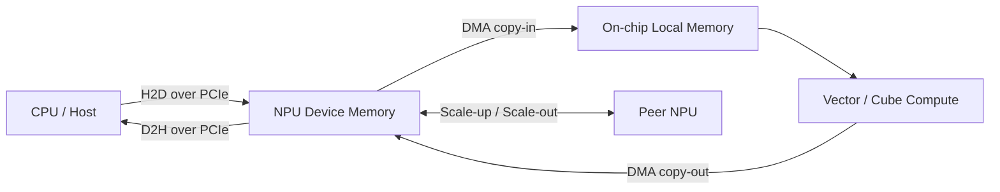

# Infra Knowledge

面向 AI 基础设施学习者的中英双语知识库。目前从 NPU 入门：先建立硬件层级、数据搬运和集群网络的整体视图，
再逐步补充算子、通信、性能分析和故障定位。

[:material-translate: 中文学习路线](zh/index.md){ .md-button .md-button--primary }
[:material-translate: English learning path](en/index.md){ .md-button }

!!! note "阅读提示 / Reading note"

    NPU 产品的内部结构、端口名称和拓扑会随厂商与代际变化。本文优先解释稳定的概念，并在具体实现可能变化时明确标注。
